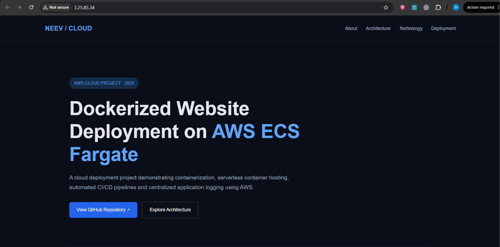
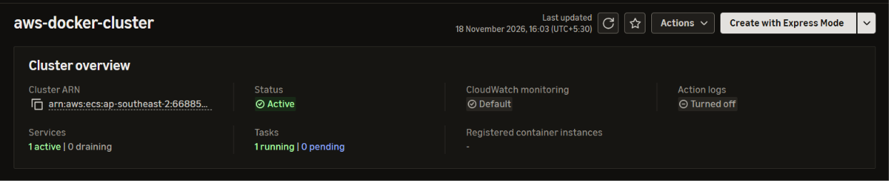
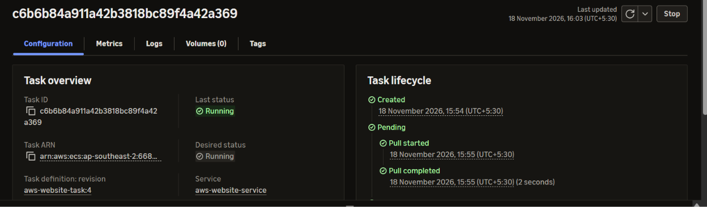
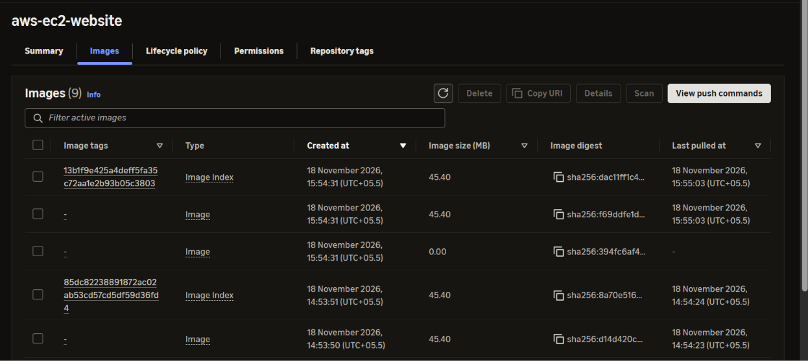
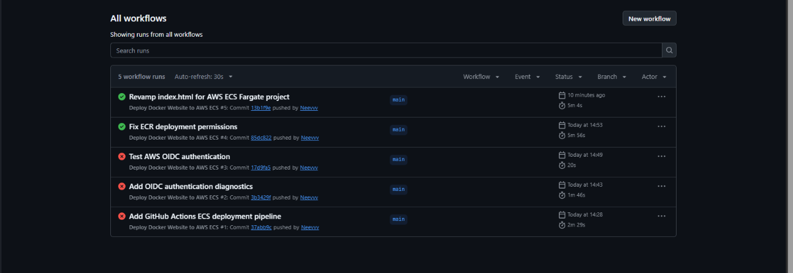
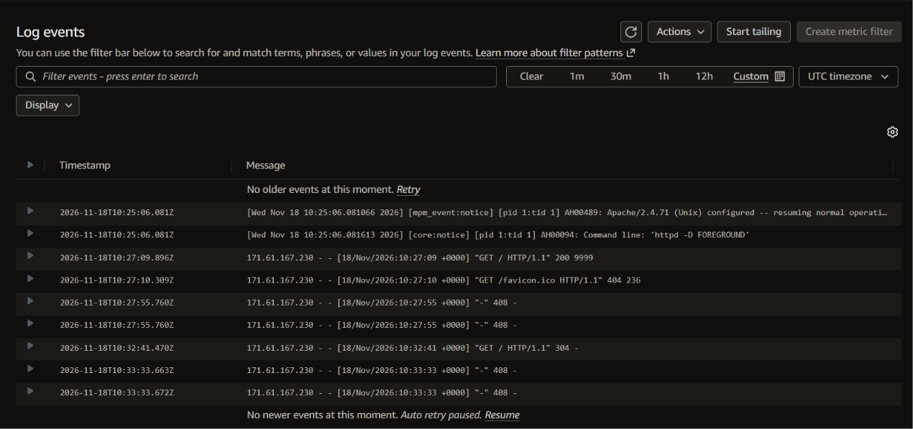

# Dockerized Website Deployment on AWS ECS Fargate

A hands-on AWS cloud project demonstrating Docker containerization, Amazon ECS deployment using Fargate, automated CI/CD with GitHub Actions, and centralized logging using Amazon CloudWatch.

## Project Overview

This project deploys a static website inside a Docker container using the Apache HTTP Server image. The container is stored in Amazon Elastic Container Registry (ECR) and deployed using Amazon Elastic Container Service (ECS) with AWS Fargate.

A GitHub Actions pipeline automates the deployment process whenever new code is pushed to the main branch.

## Architecture

```text
Developer
   |
   v
GitHub Repository
   |
   v
GitHub Actions
   |
   | AWS OIDC Authentication
   v
Amazon ECR
   |
   | Docker Image
   v
Amazon ECS
   |
   v
AWS Fargate
   |
   v
Live Website

Amazon CloudWatch
   ^
   |
Container Logs
```

## AWS Services and Technologies

| Technology | Purpose |
|---|---|
| Docker | Containerization of the website |
| Amazon ECR | Private Docker image repository |
| Amazon ECS | Container orchestration |
| AWS Fargate | Serverless container compute |
| AWS IAM | Identity and access management |
| AWS OIDC | Secure GitHub Actions authentication |
| GitHub Actions | CI/CD automation |
| Amazon CloudWatch | Container log monitoring |
| HTML / CSS | Website development |

## Implementation Steps

### 1. Docker Containerization

- Created a static website using HTML.
- Used the official `httpd:2.4` Docker image.
- Created a Dockerfile to copy the website into the Apache web server.
- Built and tested the container locally.

### 2. Amazon ECR Setup

- Created a private ECR repository.
- Authenticated Docker with AWS ECR.
- Tagged and pushed the Docker image to ECR.

### 3. Amazon ECS Deployment

- Created an ECS cluster named `aws-docker-cluster`.
- Selected AWS Fargate as the launch type.
- Created the task definition `aws-website-task`.
- Configured container port 80.
- Created the ECS service `aws-website-service`.
- Deployed the container and verified public website access.

### 4. GitHub Actions CI/CD

Configured an automated deployment workflow using GitHub Actions.

The workflow performs the following operations:

1. Detects code changes pushed to the main branch.
2. Authenticates with AWS using OpenID Connect (OIDC).
3. Builds a new Docker image.
4. Pushes the image to Amazon ECR.
5. Retrieves the current ECS task definition.
6. Updates the container image.
7. Deploys the new task definition to ECS Fargate.

### 5. CloudWatch Logging

- Created the CloudWatch log group `/ecs/aws-website`.
- Configured the ECS task definition with the `awslogs` log driver.
- Updated the ECS service to use the new task definition revision.
- Verified Apache container access logs in CloudWatch.

## Project Screenshots

### Live Website



### ECS Cluster



### Fargate Task



### Amazon ECR



### GitHub Actions Pipeline



### CloudWatch Logs



## Key Learnings

- Docker image creation and container management.
- Deploying containerized applications using Amazon ECS and Fargate.
- Managing Docker images using Amazon ECR.
- Configuring IAM roles and OIDC authentication.
- Implementing automated CI/CD pipelines.
- Monitoring container logs using Amazon CloudWatch.

## Repository

GitHub: https://github.com/Neevvv/Dockerized-Website-Deployment-on-AWS-ECS-Fargate

---

**Author:** Neev Panseriya  
**Project:** AWS Cloud Engineering  
**Region:** ap-southeast-2 (Sydney)
